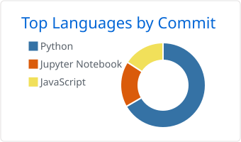

<!-- Header -->
<picture>
  <source media="(prefers-color-scheme: dark)" srcset="https://capsule-render.vercel.app/api?type=waving&height=180&color=0:1B4B6E,55:2A6283,100:C8891F&fontColor=FFF6E5&text=Haoran%20Tu%20%28Willa1m%29&fontSize=46&fontAlignY=38&desc=Data%20Science%20%40%20Boston%20University%20%2726&descSize=18&descAlignY=62&section=header&animation=none">
  
</picture>

  <picture>
    <source media="(prefers-color-scheme: dark)" srcset="https://readme-typing-svg.demolab.com?font=JetBrains+Mono&weight=500&size=19&duration=3200&pause=1400&color=F5C26B&center=true&vCenter=true&width=640&height=40&lines=Data+Scientist+%C2%B7+ML+Engineer;Building+reproducible+on-chain+data+pipelines;Turning+messy+data+into+decisions;From+dexterous-hand+debugging+to+3D+web+viewers">
    
  </picture>

  
  
  
  

<picture>
  <source media="(prefers-color-scheme: dark)" srcset="./assets/divider-dark.svg">
  
</picture>

## 01 · About

I'm Haoran, a Data Science graduate from Boston University (B.S., minor in Business Administration & Management, finished in three years).
I build things end to end — data pipelines, ML models, and the interfaces people use to read the results — and I prefer work that can be reproduced and checked.

- **Looking for** — Applied AI / ML Engineering · Embodied AI & Robotics · Data / Analytics Engineering · entry-level Software Engineering
- **Working on** — a PancakeSwap V3 LP monitor on BSC with exact on-chain math
- **Based in** — Boston, MA
- **Off hours** — Trumpet, Grade 10 (Shanghai Conservatory of Music) · HiMCM Second Prize

🇨🇳 中文简介

 

你好，我是涂皓然。波士顿大学数据科学理学学士，辅修工商管理，用三年读完了学位。

我习惯把一件事从数据一路做到界面：数据管道、模型，以及让人看懂结果的前端。我也更偏爱能复现、能校验的做法，数字要经得起回查。

最近做过的事：在 BU Spark! 为借款人权益组织分析马萨诸塞州法院的医疗信贷催收记录；为一个 3D 建筑重建平台开发前端；在达闼机器人协助灵巧手团队做动作调试和硬件验证。

- 求职方向：AI 应用与机器学习工程、具身智能与机器人、数据分析与分析工程、初级软件工程
- 正在做：BSC 链上 PancakeSwap V3 流动性仓位监控（开发中）
- 现居：波士顿
- 课余：上海音乐学院小号十级；HiMCM 数学建模竞赛二等奖

## 02 · Toolkit

<table>
<tr>
<td width="130"><b>Languages</b></td>
<td>
<picture>
  <source media="(prefers-color-scheme: dark)" srcset="https://skillicons.dev/icons?i=py,rust,js,bash,r&theme=dark">
  
</picture>
 

</td>
</tr>
<tr>
<td><b>ML &amp; Data</b></td>
<td>
<picture>
  <source media="(prefers-color-scheme: dark)" srcset="https://skillicons.dev/icons?i=pytorch,sklearn&theme=dark">
  
</picture>
 

</td>
</tr>
<tr>
<td><b>Web</b></td>
<td>
<picture>
  <source media="(prefers-color-scheme: dark)" srcset="https://skillicons.dev/icons?i=react,threejs,flask,fastapi&theme=dark">
  
</picture>
 

</td>
</tr>
<tr>
<td><b>Infra</b></td>
<td>
<picture>
  <source media="(prefers-color-scheme: dark)" srcset="https://skillicons.dev/icons?i=docker,nginx,redis,mysql,mongodb,git,linux&theme=dark">
  
</picture>
 

</td>
</tr>
</table>

## 03 · Lab Entries

Each entry: the question I started from, and what the repository can actually show.

<table>
<tr>
<td width="50%" valign="top">
<b>ENTRY 01</b> · data engineering · on-chain
<h4><a href="https://github.com/Willa1m/BSC_PancakeSwap_monitoring_Demo">PancakeSwap V3 LP Monitor</a></h4>
<b>Question</b> — How do you collect LP data that survives restarts and can be checked against the chain? 
<b>Evidence</b> — 9/9 tests · backfill and chain-vs-DB verify endpoints · <i>work in progress</i>
  
<code>FastAPI</code> <code>web3.py</code> <code>SQLAlchemy</code> <code>Decimal math</code>
 
BSC 链上流动性仓位监控：断点续采、唯一约束去重、手续费核算（开发中）
</td>
<td width="50%" valign="top">
<b>ENTRY 02</b> · backend · infra · internship
<h4><a href="https://github.com/Willa1m/crypto-monitoring-plus">Crypto Monitoring Plus</a></h4>
<b>Question</b> — How should a price dashboard behave when its cache goes down? 
<b>Evidence</b> — fallback path in <code>crypto_web_app.py</code> · Compose health checks
  
<code>Flask</code> <code>Redis → MySQL</code> <code>Nginx</code> <code>Compose</code>
 
实习期间的行情监控原型：多粒度存储、缓存回退、容器化编排
</td>
</tr>
<tr>
<td width="50%" valign="top">
<b>ENTRY 03</b> · full stack · documents
<h4><a href="https://github.com/Willa1m/What_Format">What Format</a></h4>
<b>Question</b> — How far can plain rules go in parsing resume sections? 
<b>Evidence</b> — rule set in <code>smart_classifier.py</code> · accuracy not measured yet
  
<code>FastAPI</code> <code>PDF/DOCX</code> <code>Three.js</code> <code>i18n</code>
 
简历与求职信格式整理工具：规则式分段识别，中英双语前端
</td>
<td width="50%" valign="top">
<b>ENTRY 04</b> · machine learning · DS 340
<h4><a href="https://github.com/Willa1m/DS340_Finalproject">EUR/USD Forecasting with News Sentiment</a></h4>
<b>Question</b> — Does daily news sentiment help an LSTM forecast EUR/USD? 
<b>Evidence</b> — not shown: no price-only baseline and one week of data; the README has a written retrospective
  
<code>PyTorch</code> <code>LSTM</code> <code>VADER</code> <code>3-source scraper</code>
 
双人课程项目：LSTM 结合新闻情感预测汇率，并如实复盘结论的局限
</td>
</tr>
<tr>
<td width="50%" valign="top">
<b>ENTRY 05</b> · algorithms · Rust · DS 210
<h4><a href="https://github.com/Willa1m/Haoran-Tu-Project">Game Platform Graph Analysis</a></h4>
<b>Question</b> — Which game platforms sit at the center of the release network? 
<b>Evidence</b> — <code>cargo build</code> ✓ · 2 unit tests
  
<code>Rust</code> <code>petgraph</code> <code>centrality</code> <code>densest subgraph</code>
 
Rust 课程项目：游戏平台关系图的度分布、中心性与稠密子图分析
</td>
<td width="50%" valign="top">
<b>ENTRY 06</b> · simulation · testing
<h4><a href="https://github.com/Willa1m/AutoBattle_Game">AutoBattle Engine</a></h4>
<b>Question</b> — Can a game's rules be built and verified before any UI exists? 
<b>Evidence</b> — 63 tests passing (unittest and pytest)
  
<code>Python stdlib</code> <code>unittest</code> <code>battle simulator</code>
 
中国神话题材自走棋引擎，63 个测试覆盖核心逻辑
</td>
</tr>
</table>

## 04 · Field Log

| Role | What I did |
|---|---|
| **Data Analyst (team)** BU Spark! × MassMutual × Protect Borrowers 2026 Spring · Boston | Filtered ~3.7M Massachusetts court records to ~31K Synchrony-related and ~1K CareCredit / medical-credit candidates with SQL and regex; visualized judgment amounts and court-level concentration. |
| **Software Development Intern** PowSell Technology 2025 Summer · Shenzhen | Built a BTC/ETH price-monitoring prototype with AI-assisted development under a project lead: Flask REST API, Redis cache with DB fallback, Docker Compose. |
| **Intern, Robots & Devices HW** CloudMinds Robotics 2024 Summer · Shenzhen | Motion debugging and hardware validation for a 6-DoF dexterous hand over CAN bus; traced a power fault from the current readings returned by the protocol. |

**Selected coursework** — code not public; write-ups coming soon

- **AI-Driven 3D Architectural Reconstruction** (DS 549, BU Spark!) — I built the frontend: three modules on React + Three.js, a PLY loader, and REST / WebSocket job events. The backend was built by teammates. Early on I set up the Nerfstudio pipeline on the BU SCC GPU cluster (COLMAP poses, 30K-step Nerfacto). Demoed at BU CDS demo day.
- **Deep Learning** (DS 542) — a ~3.2M-parameter decoder-only Transformer (99.2–100% full-sequence exact match across 10 configs), EfficientNet-B0 fine-tuning on 10 butterfly classes (90.88% val. accuracy), and a 60-epoch DDPM on 22,000 64×64 images via SGE batch jobs.

## 05 · Activity

  <picture>
    <source media="(prefers-color-scheme: dark)" srcset="./profile-summary-card-output/github_dark/2-most-commit-language.svg">
    
  </picture>

<picture>
  <source media="(prefers-color-scheme: dark)" srcset="https://raw.githubusercontent.com/Willa1m/Willa1m/output/github-snake-dark.svg">
  
</picture>

End of notebook · Thanks for reading. Reliable systems, honest numbers.

<!-- Footer -->
<picture>
  <source media="(prefers-color-scheme: dark)" srcset="https://capsule-render.vercel.app/api?type=waving&height=110&section=footer&animation=none&color=0:C8891F,45:2A6283,100:1B4B6E">
  
</picture>
